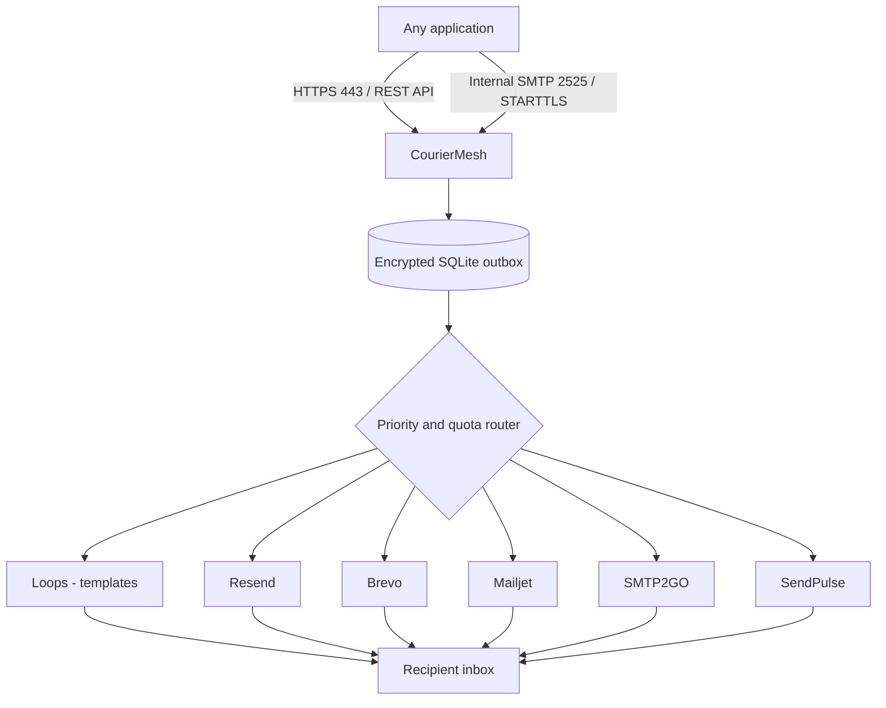

<div align="center">


# CourierMesh

**One endpoint. Six delivery adapters. Your limits, under control.**

An open-source, self-hosted, **OTP-only** email delivery gateway for any application requiring verification codes. Deploy on a single VM without a paid database, Redis queue, or proprietary backend.

    

[Quick start](#quick-start) · [Providers](#providers) · [Provider setup](docs/PROVIDERS.md) · [Architecture](#architecture) · [Security](docs/SECURITY.md) · [API](docs/API.md) · [OpenAPI](docs/openapi.yaml) · [Deployment](docs/DEPLOYMENT.md) · [Operations](docs/OPERATIONS.md)

</div>

---

## Why CourierMesh?

Connect applications to multiple email delivery providers without exposing an outbound SMTP port 25 dependency. CourierMesh accepts OTP messages through **one authenticated HTTPS API** or **one internal SMTP endpoint**, then hands them to whichever configured provider has available capacity.

It does not bypass the terms, approval requirements, abuse checks, or quotas imposed by a provider. Your account is responsible for ensuring that its sending volume and domain authorization are valid.

### At a glance

| Capability | Included |
|---|---|
| Six provider integrations | Loops, Resend, Brevo, Mailjet, SMTP2GO, SendPulse |
| Application connectivity | HTTPS JSON API + authenticated SMTP submission |
| Quota policies | Per-provider per-minute, per-hour, per-UTC-day, rolling 30-day caps |
| Routing | Priority-based with quota-aware fallthrough |
| Availability | Durable SQLite outbox, configurable parallel workers |
| Safety | No retry if provider acceptance is uncertain |
| Access | Scoped application keys, one-time token display, sender allowlist |
| Visibility | Browser admin console, message states, quota meters, provider list |
| Encryption | AES-256-GCM encryption for provider credentials, private OTP templates and queued OTP payloads |
| Infrastructure | Docker, Easypanel, SQLite, one service |
| Privacy | No analytics, no tracking pixels, no marketing list synchronization |

**Limits of scope:** CourierMesh does not host mailboxes, receive MX mail, verify inbox delivery, handle bounces automatically, manage marketing audiences, or offer guaranteed exactly-once external delivery. Read [Design decisions](docs/ARCHITECTURE.md).

## Architecture



All six provider adapters make outbound requests over HTTPS **port 443**. This design works on hosts where direct outbound SMTP port 25 is restricted, provided the selected providers permit sending from your account.

## Quick start

Requirements: Docker Engine and Docker Compose. Production containers run Node.js 22 with SQLite built in. **No `npm install` required.**

```bash
cp .env.example .env
node -e "console.log(require('node:crypto').randomBytes(32).toString('hex'))"
node -e "console.log(require('node:crypto').randomBytes(32).toString('hex'))"
# Use DIFFERENT outputs in .env:
# ADMIN_TOKEN=<32+ random chars>
# ENCRYPTION_KEY=<64 hexadecimal chars>
# ALLOWED_SENDERS=no-reply@notify.yourdomain.com

docker compose up -d --build
curl -fsS http://127.0.0.1:8080/healthz
```

Open the admin console on `http://127.0.0.1:8080` through an HTTPS reverse proxy for remote access. For SSH-only access, use `ssh -L 8080:127.0.0.1:8080 ubuntu@YOUR_SERVER` and open `http://localhost:8080` locally. **Never publish admin HTTP directly to the Internet without TLS.**

1. Sign in using your `ADMIN_TOKEN`.
2. Add and enable a provider with verified sending domain, API credentials, and quotas.
3. Configure your private OTP subject, text, and optional HTML under **OTP Template**. Nothing you enter there is committed to GitHub.
4. Create an application key with an exact authorized sender address.
5. Connect via HTTPS API (preferred) or authenticated private-network SMTP with `X-CourierMesh-OTP` header.
6. Run a real single-recipient acceptance and inbox test before sending production traffic.

For Easypanel instructions, persistent storage, networking, TLS trust, and deployment constraints, see [Deployment](docs/DEPLOYMENT.md).

## Providers

| Adapter | Input | Provider account prerequisites | Typical purpose |
|---|---|---|---|
| **Loops** | OTP | API key and published OTP transactional ID | Provider-side OTP template |
| **Resend** | OTP | API key and verified sender/domain | Private gateway OTP template |
| **Brevo** | OTP | API key and verified sender/domain | Private gateway OTP template |
| **Mailjet** | OTP | API key, secret and verified sender | Private gateway OTP template |
| **SMTP2GO** | OTP | API key and verified sender | Private gateway OTP template |
| **SendPulse** | OTP | API client ID, secret and approved account | Private gateway OTP template |

**Private template:** configure the subject, text, optional HTML and RTL/LTR direction in the admin dashboard. Use `{{code}}` for dynamic substitution. The template content stays AES-256-GCM-encrypted in SQLite under your private persistent `/data` volume, never in GitHub. The five non-Loops adapters all use this same template. Loops retains its separate published template and cannot automatically sync its HTML. See [Private OTP templates](docs/PRIVATE-OTP-TEMPLATES.md).

**OTP-only:** REST submissions containing `kind: raw`, `text` or `html` are rejected. SMTP clients must supply `X-CourierMesh-OTP`, and arbitrary SMTP mail is rejected. No receipts, marketing campaigns, notifications or general mail are permitted by this gateway.

### Conservative dashboard defaults (verify against your plan)

| Provider | Daily | 30-day | Hourly | Minute |
|---|---:|---:|---:|---:|
| Loops | 0 (no daily cap set) | 4,000 | 600 | 8 |
| Resend | 100 | 3,000 | 100 | 4 |
| Brevo | 300 | 9,000 | 300 | 5 |
| Mailjet | 200 | 6,000 | 200 | 3 |
| SMTP2GO | 200 | 1,000 | 200 | 3 |
| SendPulse | 400 | 12,000 | 50 | 1 |

These defaults are *locally configured safety budgets*, **not** verified account entitlements. Provider offers, rate limits, account status and terms change. The monthly cap is a conservative **rolling 30-day window**. Daily resets at **00:00 UTC**. A zero cap means *no local cap*—it does not change the provider's own cap. Set more restrictive numbers for new/unapproved accounts.

## Send an OTP (HTTPS)

```bash
curl -X POST https://mail-gateway.example.com/v1/send \
  -H 'Authorization: Bearer KEY_ID.SECRET' \
  -H 'Idempotency-Key: signup-user-123' \
  -H 'Content-Type: application/json' \
  -d '{"kind":"otp","from":"no-reply@notify.example.com","to":"recipient@example.net","code":"123456"}'
```

The sender does not specify the email's subject or message body; the central template controls them. Loops uses its published OTP transactional template, while the other five providers use the private gateway template. See [API reference](docs/API.md).

```json
{"id":"75f...","status":"queued","duplicate":false}
```

A `202` response means the request is **durably queued**, **not delivered**. Poll `GET /v1/messages/{id}` using the same application key to observe `accepted`, `failed`, `expired`, or `unknown`. For time-sensitive messages such as OTP codes, align your application's expiration policy with the gateway queue deadline. Never expose the application key to browser JavaScript.

For SMTP usage, see [API and SMTP](docs/API.md). For the implementation details of quota routing and crash recovery, see [Architecture](docs/ARCHITECTURE.md).

## Project structure

```text
couriermesh/
├── src/                  # Node 22 server, SMTP, SQLite outbox, provider adapters
├── public/               # Responsive control plane + vector brand mark
├── docs/                 # Architecture, deployment, API, operations, security
├── tests/                # Node built-in test runner
├── examples/             # Integration samples
├── .github/workflows/    # Continuous integration
├── Dockerfile
├── compose.yaml
├── .env.example
└── LICENSE
```

## Development

```bash
node --version        # 22.13+ recommended
npm run check
npm test
```

The core runtime is dependency-free, enabling offline tests and limiting supply-chain exposure. SQLite support in Node.js 22 is currently marked experimental; pin a known-working Node image and validate newer releases before deployment. The Dockerfile currently uses Node 22; for strict production reproducibility, pin it to a tested patch or digest.

## Open-source project

MIT licensed. Contributions are welcome: see [Contributing](CONTRIBUTING.md), [Code of Conduct](CODE_OF_CONDUCT.md), and [Security policy](SECURITY.md). Please follow providers' published rate limits and anti-spam rules. This project is not affiliated with Loops, Resend, Brevo, Mailjet, SMTP2GO or SendPulse.

### Release readiness

The repository includes unit/integration tests with simulated provider responses and a functional local SMTP/API path. **Live provider delivery, real-world DNS alignment, Easypanel deployment, load testing, independent security review, and 1,000-user launch validation still require real accounts and deployment access.** Do not assume a provider's acceptance response means the message reached the inbox.

## GitHub and private content

Only code, generic examples and documentation belong in this public repository. Keep your actual OTP message content in the **OTP Template** settings on the running server, backed by a persistent and backed-up `/data` volume. Never commit `.env`, production templates, private TLS keys or the encryption key. The project's public source may be reused without reproducing anyone's private template.
